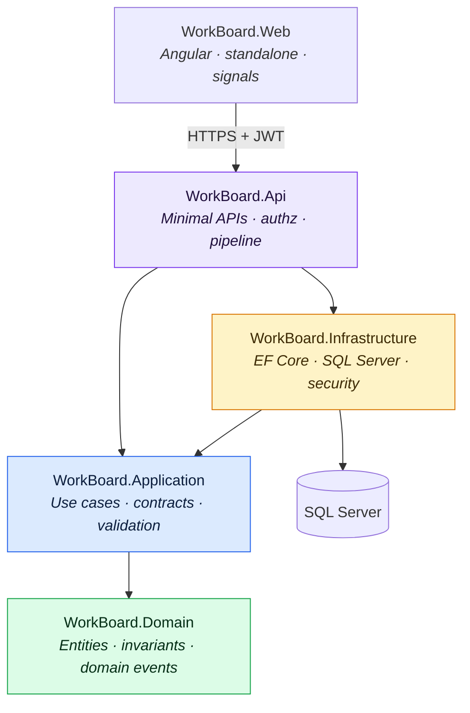
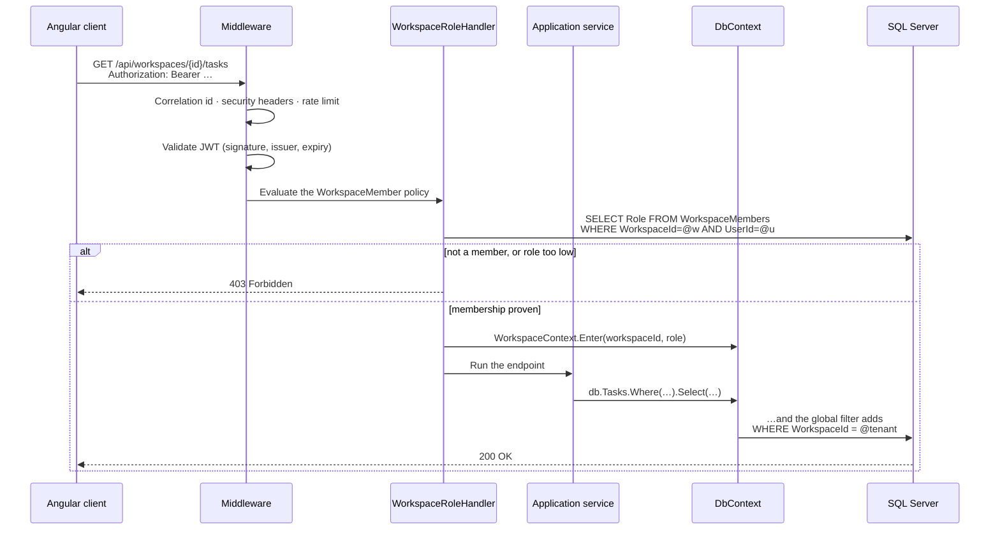
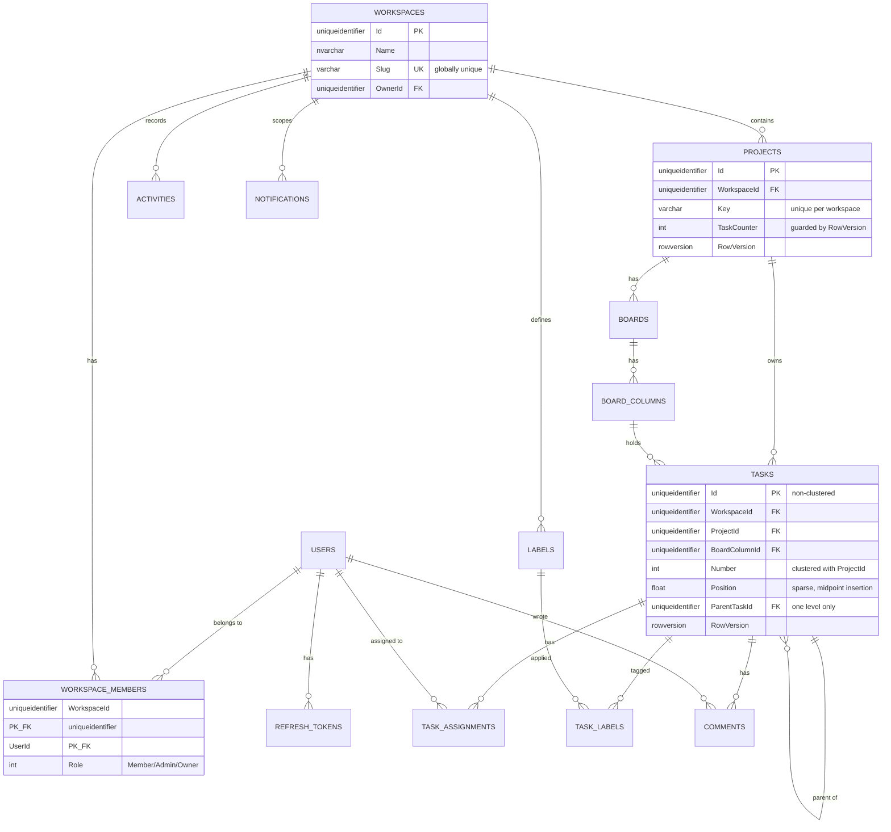
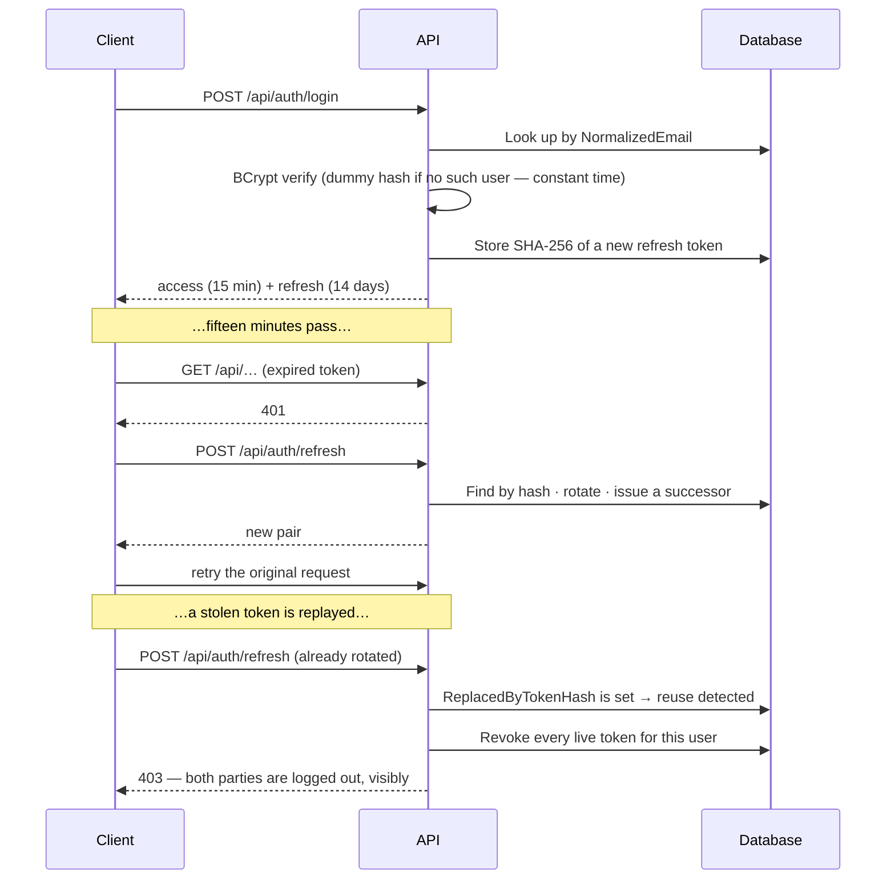
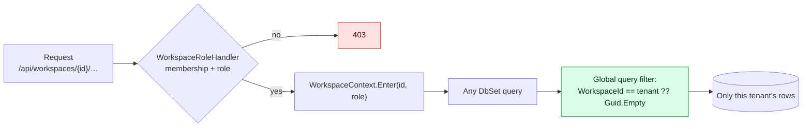
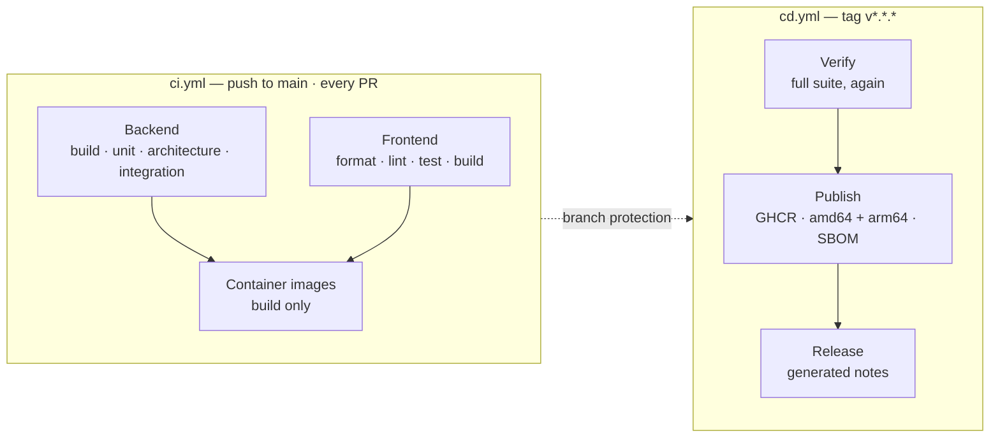

<div align="center">

# WorkBoard

**Project and task management, built to show how the pieces fit — not just that they work.**

[](https://github.com/omatheusribeiro/WorkBoard/actions/workflows/ci.yml)
[](https://github.com/omatheusribeiro/WorkBoard/actions/workflows/cd.yml)
[](https://dotnet.microsoft.com/)
[](https://angular.dev/)
[](https://learn.microsoft.com/ef/core/)
[](https://www.microsoft.com/sql-server)
[](LICENSE)

</div>

---

## Overview

WorkBoard is a smaller, honest version of Jira or Linear: workspaces, projects, Kanban boards with
drag-and-drop, tasks with subtasks, comments, labels, priorities, deadlines, assignment, a change
history, notifications, filtering, search and a dashboard.

The features are ordinary on purpose. What the repository is actually about is everything underneath
them:

- **Multi-tenancy that cannot be bypassed by forgetting a `Where` clause** — enforced by an EF Core
  global query filter applied to every tenant-scoped entity by convention, bound to the request by
  the authorisation handler that proved membership, and failing closed when unset.
- **Entity Framework Core used the way it should be** — projections on the read side, tracked
  aggregates on the write side, indexes designed from the queries that exist, and the common
  failure modes documented at the exact call sites where they were avoided.
- **Decisions written down with their trade-offs** — twelve [ADRs](docs/adr/), each naming the
  problem, the options that were real, what was chosen and what was given up.
- **125 automated tests** across three suites, including a security suite that sets up two real
  tenants and tries every route from one to the other.

Every non-obvious choice in the codebase carries a comment explaining the alternative and why it was
rejected. If you only read one file, read
[`WorkBoardDbContext`](src/WorkBoard.Infrastructure/Persistence/Context/WorkBoardDbContext.cs).

---

## Demo

```bash
git clone https://github.com/omatheusribeiro/WorkBoard.git
cd WorkBoard
docker compose up --build
```

| | |
| --- | --- |
| Web | <http://localhost:4200> |
| API reference | <http://localhost:5080/scalar/v1> |
| Health | <http://localhost:5080/health> |
| SQL Server | `localhost,1433` · `sa` / `Your_password123` |

The Development database is migrated and seeded on startup. Sign in as any of:

| Email | Password | Role |
| --- | --- | --- |
| `ada@workboard.dev` | `WorkBoard!2025` | Owner of *Acme Product* |
| `grace@workboard.dev` | `WorkBoard!2025` | Admin of *Acme Product* |
| `alan@workboard.dev` | `WorkBoard!2025` | Member of *Acme Product* |
| `outsider@other.dev` | `WorkBoard!2025` | Owner of *Rival Corp* |

The seed creates **two** populated workspaces deliberately. Sign in as Ada, copy a project id, then
sign in as the outsider and try to reach it — the isolation story is meant to be tried, not taken on
trust.

---

## Features

| Area | What it does |
| --- | --- |
| **Accounts** | Registration, login, refresh-token rotation with reuse detection, logout. |
| **Workspaces** | Create, rename, archive. Members with Owner / Admin / Member roles, ownership transfer. |
| **Projects** | Per-workspace key (`PLAT-1`, `PLAT-2`), created with a default Kanban board, archivable. |
| **Boards** | Columns with a semantic status category and optional WIP limits; reorderable. |
| **Tasks** | Title, description, priority, deadline, assignees, labels, one level of subtasks. |
| **Drag and drop** | Angular CDK, applied optimistically, reconciled against the server, safe under concurrent edits. |
| **Comments** | Threaded per task, editable by the author, soft-deleted by the author or an admin. |
| **Labels** | Workspace-wide taxonomy with a colour, unique per workspace. |
| **History** | Every change written from a domain event inside the same transaction. |
| **Notifications** | In-app, produced by the same events, with an unread badge. |
| **Dashboard** | Totals, status and priority breakdowns, 14-day throughput, per-project progress, your open tasks. |
| **Search** | Tasks, projects and comments, capped and tenant-scoped. |
| **Filtering** | Project, status, priority, label, assignee, overdue, free text — all applied in SQL. |

---

## Architecture

Four projects, dependencies pointing inwards only.



**The domain has no dependencies at all** — not EF Core, not ASP.NET Core, not the DI container. Its
rules are exercisable without a database, and an architecture test fails the build if that stops
being true.

**The application layer depends on abstractions it defines**, grouped by what they abstract:
a flat `Application/Interfaces`: `IWorkBoardDbContext`, `IUnitOfWork`, one repository per aggregate,
`ICurrentUser`, `ITenantContext`, `ITokenService`, `IPasswordHasher`, `IClock`. Infrastructure supplies
every one of them, which is what makes the dependency arrow point inwards despite the runtime
relationship being the other way round.

**One class per use case.** `Application/UseCases/<Aggregate>/<Operation>/` holds an interface and a
sealed class with a single `ExecuteAsync` — fifty-one of them, and the directory listing is the
inventory of everything the application can do. Four architecture tests keep it that way. See
[ADR-014](docs/adr/014-use-case-per-operation.md) for what that cost and why it was worth it.

**Reads and writes use the database differently**, and no use case does both:

| | Depends on | Loads | Why |
| --- | --- | --- | --- |
| Read use cases | `IWorkBoardDbContext` | projections to DTOs | LINQ composes into one statement; nothing is tracked, and only the listed columns are read |
| Write use cases | aggregate repositories + `IUnitOfWork` | tracked aggregates | the domain object enforces its invariants, then the work commits once |

**There is still no generic repository.** The eight repository interfaces share no base type and no
members, because loading a task for modification and loading a workspace for modification are not the
same operation. They exist for one reason: the correct `Include` set per aggregate was being copied
into every service that needed it, and the copies had already drifted. Reads never go through them.
The original decision is [ADR-001](docs/adr/001-use-entity-framework-core.md); what changed, and what
it cost, is [ADR-013](docs/adr/013-write-repositories-alongside-the-context.md).

**Mapping is expression trees, not a mapper.** `Application/Mappings/<Aggregate>/XMappings.cs` holds
`Expression<Func<TEntity, TDto>>` projections that are handed to EF Core and become the SELECT list.
A convention-based mapper would run after materialisation, which is the cost the projections exist to
avoid — see ADR-013 for why AutoMapper is absent.

### The request path



The important detail: **binding the tenant is a side effect of passing authorisation.** The same code
proves membership and sets the filter value, so there is no path that reaches a handler with a
workspace set but unverified.

---

## Stack

| Layer | Choice | Why |
| --- | --- | --- |
| Runtime | .NET 10 | Current LTS-track runtime; minimal APIs and native OpenAPI. |
| API | ASP.NET Core minimal APIs | Endpoint-level filters and policies without controller ceremony. |
| Data | EF Core 10 | [ADR-001](docs/adr/001-use-entity-framework-core.md) |
| Database | SQL Server 2022 | `rowversion`, filtered indexes — [ADR-002](docs/adr/002-use-sql-server.md) |
| Client | Angular 22 | Standalone, signals, zoneless — [ADR-003](docs/adr/003-use-angular.md) |
| Drag and drop | Angular CDK | Accessible, keyboard-operable, no third-party dependency. |
| Validation | FluentValidation | Rules as code, applied by an endpoint filter. |
| Auth | JWT + rotating refresh tokens | [ADR-006](docs/adr/006-use-jwt.md) |
| Hashing | BCrypt (cost 12) | Cost factor stored in the hash, so it can be raised later. |
| Logging | Serilog | Structured, with a correlation id on every line. |
| Tracing | OpenTelemetry | ASP.NET Core, HttpClient, SqlClient and runtime instrumentation. |
| Tests | xUnit · FluentAssertions · NSubstitute · Testcontainers · NetArchTest | Real database, real HTTP, enforced boundaries. |
| Containers | Docker, multi-stage | Non-root, health-checked, ~110 MB API image. |
| CI/CD | GitHub Actions + GHCR | [ADR-005](docs/adr/005-use-github-actions.md) |

---

## Project structure

```
WorkBoard/
├── src/
│   ├── WorkBoard.Domain/                    # No dependencies at all.
│   │   ├── Entities/                        #   The aggregates, plus the Entity base type
│   │   ├── Enums/                           #   TaskPriority, TaskStatusCategory, WorkspaceRole…
│   │   ├── Events/                          #   Thirteen domain events, one per file
│   │   ├── Exceptions/                      #   DomainException and the Guard clauses that throw it
│   │   └── Interfaces/                      #   IWorkspaceScoped, IAuditable, IDomainEvent
│   │
│   ├── WorkBoard.Application/               # Use cases. Depends on Domain + interfaces it defines.
│   │   ├── UseCases/<Aggregate>/<Operation>/#   51 of them: ICreateTaskUseCase + CreateTaskUseCase,
│   │   │                                    #   one public ExecuteAsync each
│   │   ├── DTOs/<Aggregate>/                #   Requests and responses, one per file
│   │   ├── Interfaces/                      #   IWorkBoardDbContext, IUnitOfWork, I…Repository,
│   │   │                                    #   ICurrentUser, ITenantContext, ITokenService, IClock
│   │   ├── Validators/<Aggregate>/          #   FluentValidation, one per request
│   │   ├── Mappings/<Aggregate>/            #   Expression<Func<TEntity, TDto>> projections
│   │   ├── Services/                        #   The four rules shared by several use cases
│   │   ├── Exceptions/                      #   NotFound, Forbidden, Conflict
│   │   ├── Extensions/                      #   WhereIf, ToPagedResultAsync, NotDeleted
│   │   └── Logging/                         #   Source-generated [LoggerMessage] delegates
│   │
│   ├── WorkBoard.Infrastructure/            # EF Core, SQL Server, security primitives.
│   │   ├── Persistence/
│   │   │   ├── Context/                     #   DbContext, factory, UnitOfWork, WorkspaceContext
│   │   │   ├── Configurations/              #   Fluent API: keys, indexes, delete behaviour
│   │   │   ├── Repositories/                #   The eight write-side repositories
│   │   │   ├── Initialization/              #   Migrate-on-start, wait-for-server, demo seed
│   │   │   └── Migrations/
│   │   ├── Services/                        #   Clock, domain-event dispatcher, activity/notification writers
│   │   ├── Authentication/                  #   JWT, BCrypt, claim and policy names
│   │   └── DependencyInjection/             #   One registration file per concern
│   │
│   ├── WorkBoard.Api/                       # Transport.
│   │   ├── Endpoints/                       #   One file per resource
│   │   ├── Contracts/                       #   Query-string and body shapes owned by the transport
│   │   ├── Middleware/                      #   Correlation id, security headers, ProblemDetails handler
│   │   ├── Filters/                         #   The validation endpoint filter
│   │   ├── Extensions/                      #   AddWorkBoard* registrations, pipeline, rate limits
│   │   ├── Security/                        #   Workspace authorization handler, HttpCurrentUser
│   │   └── Program.cs                       #   52 lines: a table of contents
│   │
│   └── WorkBoard.Web/                       # Angular client.
│       └── src/app/
│           ├── core/
│           │   ├── api/                     #   One service per resource + WorkspaceScope
│           │   ├── enums/                   #   One string union per file
│           │   ├── models/                  #   One file per resource, re-exported from index.ts
│           │   └── auth/ config/ workspace/ notifications/
│           ├── shared/
│           │   ├── components/              #   page-header, loading-state, empty-state, priority-badge,
│           │   │                            #   label-chip, assignee-list, toast-host — .ts/.html/.scss each
│           │   └── utils/                   #   initialsOf
│           ├── layout/                      #   Shell: sidebar, workspace selector
│           └── features/                    #   auth, dashboard, workspaces, projects, boards, tasks,
│                                            #   activity, notifications, search, settings
├── tests/                                   # One project per layer; each references only that layer.
│   ├── WorkBoard.Domain.Tests/              # 56 — invariants and domain events, no database
│   ├── WorkBoard.Application.Tests/         # 38 — use cases against substituted repositories
│   ├── WorkBoard.Infrastructure.Tests/      # 12 — tokens, hashing, clock
│   ├── WorkBoard.ArchitectureTests/         # 24 — layering, registration, file conventions
│   └── WorkBoard.IntegrationTests/          # 45 — real HTTP, real SQL Server via Testcontainers
├── docker/                                  # Dockerfiles, nginx config, runtime-config entrypoint
├── docs/adr/                                # Fourteen decision records
└── .github/workflows/                       # ci.yml, cd.yml
```

**Four folders from the reference layout are deliberately absent**, because inventing empty
directories to match a diagram is cargo cult: `Domain/ValueObjects` (this model uses guarded
primitives — `ColorHex` and `ProjectKey` are the candidates if that changes),
`Application/Behaviors` (a MediatR pipeline concept; validation runs as an endpoint filter, see
[ADR-010](docs/adr/010-no-mediatr.md)), `Infrastructure/Cache` and `Infrastructure/Integrations`
(there is no cache and no external service), and `Api/Controllers` (minimal APIs — the routes are in
`Endpoints/`). `ArchitectureTests` is the one addition: it is not in the reference layout, and it is
what keeps the rest of it true.

**Every file declares one public type, named after the file.** Two architecture tests enforce it by
reading the sources, because the drift is always reasonable in the moment — a DTO is two lines, a
validator belongs next to what it validates — and the result was a `TaskContracts.cs` holding
fourteen types where the only way to find `MoveTaskRequest` was full-text search. The Angular side
follows the same rule: no component carries an inline template or inline styles.

---

## Database model



Every tenant-scoped table carries `WorkspaceId`, even where it could be derived. That duplication is
deliberate — see [ADR-004](docs/adr/004-use-modular-monolith.md).

### Indexes, and the query each one exists for

| Index | Query it serves |
| --- | --- |
| `UX_Users_NormalizedEmail` | Login, on a lower-cased column so it stays seekable regardless of collation. |
| `IX_WorkspaceMembers_UserId` (includes `Role`) | "Which workspaces do I belong to" — the workspace switcher. |
| `UX_Projects_WorkspaceId_Key` | Project key uniqueness; also the tenant-filtered lookup. |
| `CUX_Tasks_ProjectId_Number` **(clustered)** | The WB-42 uniqueness rule *and* ascending physical order per project. |
| `IX_Tasks_BoardColumnId_Position` (includes title, priority, due date) | The board read — covering, so the 10 KB description column is never touched. |
| `IX_Tasks_WorkspaceId_DueAtUtc` *(filtered)* | Overdue queries. Excludes rows with no deadline. |
| `CIX_Activities_WorkspaceId_OccurredAtUtc_Id` **(clustered)** | The feed, read backwards; appends stay at the end of each tenant's range. |
| `IX_Notifications_…_Unread` *(filtered on `IsRead = 0`)* | The unread badge. Rows leave the index once read. |
| `IX_Comments_TaskId_CreatedAtUtc` *(filtered)* | A comment thread, excluding tombstones. |

---

## Why Entity Framework Core?

The question a reviewer should ask is not "did you use an ORM" but "do you know what it costs". Both
halves are below.

### What it buys

- **Productivity without giving up the model.** Aggregates stay rich — private setters, factory
  methods, invariants enforced in the entity — and EF maps them through backing fields. The domain is
  not shaped by the database.
- **LINQ that composes.** A filter added to a query becomes a clause in one SQL statement. Grouping,
  paging and correlated subqueries translate rather than falling back to memory.
- **Change tracking.** A write path is "load, mutate, save"; the UPDATE is derived, and only for
  columns that actually changed.
- **Migrations.** The schema is generated from the model and versioned alongside the code.
- **Relationships declared once**, in Fluent API, including delete behaviour, indexes and concurrency
  tokens.
- **A unit of work.** One `SaveChangesAsync` is one transaction — which is what lets a task, its
  history entry and its notifications commit or fail together.

### What it costs, and what is done about it

| Risk | What it looks like | What this project does |
| --- | --- | --- |
| **Cartesian explosion** | Stacked `Include`s multiply rows: a 200-task board with 3 assignees and 3 labels each returns ~1,800 rows, most of them duplicated task columns. | The board is a **single projection**. Nested `Select`s become correlated subqueries; only the listed columns are read. See the remarks on [`BoardMappings.ToBoard`](src/WorkBoard.Application/Mappings/Boards/BoardMappings.cs). |
| **N+1** | A forgotten `Include` becomes one query per row, at render time, far from the code responsible. | **Lazy loading is not merely disabled — the Proxies package is not referenced at all.** Every load is an explicit `Include` or a projection. |
| **Unnecessary tracking** | Read queries materialise entities and build a change-tracking graph nothing will use. | Every read either projects to a DTO or says `AsNoTracking` explicitly. |
| **Global `NoTracking` "fix"** | Setting it globally looks free and silently turns every write into a no-op — `SaveChanges` persists what the tracker knows about. | Tracking stays at the default. The cost is paid per read query, where it is visible. [Found by running the app, not by reading about it.](docs/adr/001-use-entity-framework-core.md) |
| **Loading to count** | `project.Tasks.Count(...)` in memory transfers every task to produce an integer. | Counts are `COUNT` subqueries inside the projection. |
| **Unbounded reads** | A list endpoint returns the whole table. | `PageRequest` clamps page size to 100; search caps at 8 results per type. |
| **Unstable paging** | `OFFSET/FETCH` without a unique tiebreaker can return the same row on two pages. | Every ordering ends in a unique column. There is an integration test that pages through tied data and asserts no duplicates. |
| **Client evaluation** | A method with no SQL translation silently falls back to memory — or, in EF Core, throws at runtime. | Caught in review and by integration tests against a real database. `Convert.ToBase64String` in a projection was one; it is now a raw `byte[]` the serialiser encodes. |
| **Bulk updates bypass everything** | `ExecuteUpdate` skips the tracker, so domain events do not fire. | Used exactly once — marking notifications read — with a comment explaining why that is acceptable there. |

### Performance practices, with the file to look at

```csharp
// Projection, not Include. One statement, only the needed columns, nothing tracked.
await db.Boards
    .AsNoTracking()
    .Where(b => b.Id == boardId)
    .Select(b => new BoardView(
        b.Id, b.Name, b.ProjectId, b.Project.Key,
        b.Columns.OrderBy(c => c.Position).Select(c => new BoardColumnView(
            c.Id, c.Name, c.Position, c.Category, c.WipLimit,
            c.Tasks.Count(t => t.ParentTaskId == null),     // COUNT in SQL
            c.Tasks.Where(t => t.ParentTaskId == null)
                .OrderBy(t => t.Position)
                .Select(t => new BoardCardView(/* … */))
                .ToList()))
            .ToList()))
    .FirstOrDefaultAsync(cancellationToken);
```

| Practice | Where |
| --- | --- |
| `AsNoTracking` on every read | every read use case under `UseCases/` |
| Projection to DTOs, as reusable expression trees | `Mappings/*/*Mappings.cs` |
| `WhereIf` so unused filters contribute no SQL | `Extensions/QueryableExtensions.cs` |
| Paging with a clamped page size and a unique tiebreaker | `DTOs/Common/PageRequest.cs`, `ListTasksUseCase.ApplySort` |
| `GroupBy` translated to SQL, not applied in memory | `GetDashboardUseCase` |
| Covering and filtered indexes | `Persistence/Configurations/*.cs` |
| `Include` only on write paths, where an invariant needs the collection | `Persistence/Repositories/*.cs` — and nowhere else |
| `ExecuteUpdateAsync` for a set-based update | `NotificationRepository.MarkAllReadAsync` |
| Sequential queries, never `Task.WhenAll` on one context | `GetDashboardUseCase.ExecuteAsync` (a `DbContext` is not thread-safe) |

**On compiled queries:** not used. They remove query-plan compilation from the hot path, and the
measured benefit is tens of microseconds against database round trips measured in milliseconds. They
would be justified by a profile showing plan compilation as a real cost — there isn't one, and adding
them now would be optimisation without evidence.

---

## Entity Framework Core in practice

### Code-first and migrations

```bash
# Add a migration after changing the model
dotnet ef migrations add AddTaskEstimates \
  --project src/WorkBoard.Infrastructure \
  --startup-project src/WorkBoard.Infrastructure \
  --output-dir Persistence/Migrations

# Apply it locally
dotnet ef database update \
  --project src/WorkBoard.Infrastructure \
  --startup-project src/WorkBoard.Infrastructure

# Undo the last one (only if it has not been applied or shared)
dotnet ef migrations remove --project src/WorkBoard.Infrastructure

# Generate the script the pipeline applies
dotnet ef migrations script --idempotent \
  --project src/WorkBoard.Infrastructure \
  --startup-project src/WorkBoard.Infrastructure \
  --output artifacts/migrate.sql
```

`WorkBoardDbContextFactory` implements `IDesignTimeDbContextFactory`, so the tooling never has to
start the API host — no JWT key, no reachable database, just the model. Set
`WORKBOARD_MIGRATIONS_CONNECTION` to point the scripting at a real server.

**Naming.** One migration per schema change, named for the change:
`InitialCreate`, `AddWorkspace`, `AddProjects`, `AddTasks`, `AddComments`. This repository currently
has one — `InitialCreate` — because the schema was designed as a unit before the first release.
Splitting it into five artificial steps would produce a history that never happened; the names above
are the convention every subsequent change follows.

**In production, migrations are not applied by the application.** `Database:MigrateOnStartup` is
false there, and the pipeline applies an idempotent script as a separate step. The five reasons are in
[ADR-012](docs/adr/012-migrations-in-the-pipeline.md).

### Concurrency

```csharp
// The client sends the token it last read. EF adds it to the WHERE clause.
db.Tasks.Entry(task).Property(t => t.RowVersion).OriginalValue = request.RowVersion;

task.MoveTo(target, current, previousPosition, nextPosition, clock.UtcNow, actorId);

try
{
    await db.SaveChangesAsync(cancellationToken);
}
catch (DbUpdateConcurrencyException)
{
    throw new ConflictException("This task was changed by someone else. Reload and try again.");
}
```

Two people dragging the same card is routine on a shared board, so the second one is **told** rather
than silently overwriting. [ADR-008](docs/adr/008-optimistic-concurrency.md).

### Transactions

Almost nothing needs an explicit transaction, because one `SaveChangesAsync` already is one. Creating
a task saves the task, its assignments, its labels, the project's counter bump and the activity and
notification rows the domain events produced — in a single commit.

Where an explicit transaction *is* needed, it must go through the execution strategy:

```csharp
// EnableRetryOnFailure is on, so EF refuses a bare BeginTransaction — it cannot replay user code.
var strategy = db.Database.CreateExecutionStrategy();

await strategy.ExecuteAsync(async () =>
{
    await using var transaction = await db.Database.BeginTransactionAsync(cancellationToken);
    // …
    await transaction.CommitAsync(cancellationToken);
});
```

---

## Authentication



- Access tokens are 15-minute HS256 JWTs carrying **identity only**.
- Refresh tokens are 256 bits of CSPRNG output, stored **only as SHA-256**, rotated on every use.
- `ClockSkew` is set to zero; the default five minutes quietly extends every token.
- Passwords use BCrypt at cost 12, and login runs in constant time whether or not the account exists.

---

## Authorization

Three policies, in [`Program.cs`](src/WorkBoard.Api/Program.cs):

| Policy | Requires |
| --- | --- |
| `WorkspaceMember` | Authenticated **and** a member of the workspace in the route. |
| `WorkspaceAdmin` | The same, with at least the Admin role. |
| `SystemAdmin` | The platform-operator claim. Never grants workspace data access. |

Both workspace policies use one handler with a different minimum role, so membership is resolved — and
the tenant bound — in exactly one place. A `FallbackPolicy` requires authentication everywhere, so an
endpoint added without a policy **fails closed** instead of shipping unauthenticated.

**Membership is read per request, never carried in the token.** It costs one seek on a composite
primary key and it buys immediate revocation: an integration test removes a member and asserts their
existing, unexpired token is refused on the very next request.

---

## Multi-tenancy

The workspace is the tenant boundary. Four mechanisms, each covering a different way it could fail:



1. **The tenant is bound by passing authorisation**, not by middleware — the same code proves
   membership and sets the filter.
2. **The filter is attached by reflection** over `IWorkspaceScoped`, so a new entity cannot be added
   without one. An architecture test asserts any type with a `WorkspaceId` implements the interface.
3. **It fails closed.** No tenant resolved means the filter compares against `Guid.Empty` and returns
   nothing — never everything.
4. **`WorkspaceId` is denormalised onto every tenant row**, so the filter is one indexed predicate and
   a query that forgets to join is still filtered.

`IgnoringTenantFilter<T>()` exists for the two operations that genuinely cannot be tenant-scoped, and
an architecture test reads the source to fail the build if anything outside a reviewed allow-list
calls it.

**What a query filter does not do: constrain writes.** `TaskRelationsService.EnsureMembersAsync` is
the explicit check for the one place that matters — assignment writes a user id, and no filter
constrains what an insert may reference. It is a shared application service rather than a private
method precisely because two use cases depend on it. There is an integration test that tries exactly
that attack, and a unit test that pins the rule without a database.

---

## Testing

```bash
dotnet test                                    # all three backend suites
cd src/WorkBoard.Web && npm run test:ci        # the frontend suite
```

One test project per layer, each referencing only the layer it exercises:

| Suite | Count | Project references | What it proves |
| --- | --- | --- | --- |
| **Domain** | 56 | Domain only | Invariants, guards and domain events, with no database and no host. |
| **Application** | 38 | Application only | Use-case orchestration against substituted repositories. |
| **Infrastructure** | 12 | Infrastructure | Token issuance, hashing, and the clock. |
| **Architecture** | 24 | Api (so all of them) | Layering, registration, and the conventions the compiler cannot enforce. |
| **Integration** | 51 | Api | Real HTTP through `WebApplicationFactory` against a real SQL Server. |
| **Frontend** | 48 | — | Authentication lifecycle, error mapping, tenant state, reusable UI components and feature screens. |

**The references are part of the test.** `WorkBoard.Domain.Tests` references the domain and nothing
else, so a rule that ever needs EF Core to exercise stops the project compiling — a louder signal
than an architecture test, and an earlier one.

**The application tests exist because of the repositories and the use-case split.** Before, the
logic lived in a service that took `IWorkBoardDbContext` and composed its own queries, so exercising
"a column from another project is rejected" meant standing up a provider and seeding four tables —
and nobody did. With substituted repositories it is three lines of arrangement.

### The tests worth reading

| Test | Why it exists |
| --- | --- |
| `An_id_from_another_workspace_does_not_resolve_even_under_a_valid_route` | The caller is a legitimate member of the route's workspace and supplies someone else's id. The handler checks nothing; the filter makes the row not exist. |
| `Removing_a_member_takes_effect_immediately_on_their_existing_token` | Proves membership is not in the JWT. |
| `A_concurrent_move_with_a_stale_token_is_rejected_with_409` | Two clients, one card, one `rowversion`. |
| `Replaying_a_rotated_refresh_token_revokes_the_whole_chain` | Reuse detection, end to end. |
| `A_wrong_password_and_an_unknown_account_fail_identically` | Same status, same body — no enumeration oracle. |
| `Someone_outside_the_workspace_cannot_be_assigned_a_task` | A query filter constrains reads, not writes. |
| `Paging_returns_each_task_exactly_once` | Seven tasks of equal priority, three pages, no duplicates. |
| `Only_auth_and_workspace_resolution_bypass_the_tenant_filter` | Reads the source; fails the build on an unreviewed bypass. |
| `An_access_token_carries_no_workspace_claims` | Turns ADR-006 into something that cannot be quietly reversed. |
| `LoginAsync_still_verifies_a_hash_when_the_account_does_not_exist` | Timing equality is a defence with no visible output; this is what stops it being optimised away. |
| `No_use_case_takes_both_the_DbContext_and_the_unit_of_work` | Keeps the read/write split from quietly collapsing back. |
| `Every_use_case_exposes_exactly_one_operation_called_ExecuteAsync` | The moment a second public method appears, the class is a service again. |
| `Each_source_file_declares_one_public_type` | Reads every source file; the reason `TaskContracts.cs` cannot come back. |
| `Every_use_case_interface_is_registered` | Builds the container and compares it against the assembly: with fifty-one registrations written by hand, a missing one fails the build rather than the first request. |

**The integration tests use a real database, never the in-memory provider.** Global query filters,
`rowversion`, filtered indexes and cascade behaviour either do not exist there or behave differently,
so a suite passing against it would prove nothing about the claims being made. They also call
`MigrateAsync`, not `EnsureCreated` — otherwise a broken migration would pass every test and fail on
deploy.

Fixtures are built **through the public API**, so setup exercises the same validation, authorisation
and tenant binding as production, and cannot construct a state the application could never produce.

---

## Docker

```bash
docker compose up --build         # the whole stack
docker compose logs -f workboard-api
docker compose down -v            # and drop the volume
```

| Service | Image | Notes |
| --- | --- | --- |
| `sqlserver` | `mcr.microsoft.com/mssql/server:2022-latest` | Health-checked; the API waits for it, then creates the database and migrates it. |
| `workboard-api` | `docker/api.Dockerfile` | Multi-stage, non-root, ~130 MB, `/health` health check. |
| `workboard-web` | `docker/web.Dockerfile` | nginx serving the built SPA, ~21 MB. |

**The database creates itself.** `DatabaseInitializer` retries the connection while SQL Server
finishes starting, then calls `MigrateAsync`, which creates the database when it is not there. So
`docker compose up` against an empty volume — and `dotnet run` against a local instance that has never
seen this project — both work with no manual step. There is no `EnsureCreated` anywhere: it builds a
schema the migration history knows nothing about, and the first migration afterwards fails.

Three things in these files are worth reading:

**The project files are copied before the source.** `restore` depends only on them, so its layer is
cached and reused for every build where no package reference changed. Copying the whole tree first
would invalidate that on every one-line code change.

**The web image is built once and configured at start.** An Angular build inlines whatever it is
given, so baking in the API URL would mean one image per environment — and then the artefact reaching
production is not the one that was tested. `docker/web-entrypoint.sh` writes `config.json` from
`API_BASE_URL` at container start, and the app fetches it before the first route renders.

---

## CI/CD



- **Integration tests use Testcontainers, not a `services:` block**, so the dependency is declared in
  code and the same test runs identically on a laptop and in CI.
- **CD re-runs the tests**, because a tag can be pushed to a commit that never passed CI.
- **`GITHUB_TOKEN` only** — `packages: write` on the publishing job, `contents: write` on the release
  job, `contents: read` everywhere else. No stored secrets at all.
- **Images are tagged `1.2.3`, `1.2` and `1`**, with `latest` withheld from prereleases.

---

## Observability

**Structured logging** with Serilog, JSON to stdout in production. Every line carries a
`CorrelationId`, taken from an inbound `X-Correlation-Id` when present (length-capped and
character-filtered first — it ends up in logs) and otherwise from the W3C trace id, so logs and traces
agree on one identifier.

**Source-generated log messages.** Every message is a `[LoggerMessage]` delegate in
[`Log.cs`](src/WorkBoard.Application/Logging/Log.cs): no boxing, compile-time template checking, and
arguments not evaluated when the level is disabled. The event-id space is reviewable in one file.

**OpenTelemetry** for traces and metrics — ASP.NET Core, HttpClient, SqlClient and runtime
instrumentation, exported over OTLP. Health probes are filtered out of tracing, because they run every
few seconds and drown the traces that matter. Set `OTEL_EXPORTER_OTLP_ENDPOINT` to collect.

**Problem details on every failure**, carrying the correlation id in the body as well as the header —
so a user can quote it from a screenshot and it can be grepped straight out of the logs. An
unexpected exception returns the id and nothing else; the detail stays in the logs, where an exception
message that might contain a connection string belongs.

---

## Getting started

### With Docker

```bash
docker compose up --build
```

### Without

**Requirements:** .NET 10 SDK, Node 24+, and SQL Server (any edition — Express, Developer or
LocalDB). `appsettings.Development.json` points at `.\SQLEXPRESS` with Windows authentication, so
there is no password to set and nothing secret is committed.

```bash
# 1. A signing key, kept outside the repository
dotnet user-secrets set "Jwt:SigningKey" "$(openssl rand -base64 48)" \
  --project src/WorkBoard.Api

# 2. Only if your SQL Server is not .\SQLEXPRESS. User secrets override the committed file.
dotnet user-secrets set "ConnectionStrings:Default" \
  "Server=(localdb)\MSSQLLocalDB;Database=WorkBoard;Integrated Security=True;TrustServerCertificate=True" \
  --project src/WorkBoard.Api

# 3. Run the API on the https profile. Development creates the database, migrates and seeds.
dotnet run --project src/WorkBoard.Api --launch-profile https   # → https://localhost:7179

# 4. Run the client, in another terminal.
cd src/WorkBoard.Web
npm install
npm start                                                        # → http://localhost:4200
```

**There is no step for `dotnet dev-certs https --trust`, and that is deliberate.** In development the
browser only ever talks to `http://localhost:4200`: the dev server proxies `/api` to the API and
terminates the TLS connection itself, so an untrusted development certificate cannot break anything.
Trust it only if you want the browser to reach `https://localhost:7179` directly — to open the API
reference there, or to call the API without the proxy. See
[Where the client gets the API URL](#where-the-client-gets-the-api-url).

The API reference is reachable over plain HTTP at <http://localhost:5180/scalar/v1>, which needs no
certificate at all; the `https` launch profile binds both ports.

**No Docker for the integration tests?** Point them at an existing server:

```bash
export WORKBOARD_TEST_CONNECTION="Server=.\SQLEXPRESS;Database=master;Integrated Security=True;Encrypt=True;TrustServerCertificate=True"
dotnet test tests/WorkBoard.IntegrationTests
```

The catalog in that string is ignored — the fixture creates a uniquely named database per run and
drops it afterwards — but it has to be one the account can already connect to.

---

## Configuration

Nothing secret is committed. `appsettings.json` holds the shape and safe defaults; every value that
would be a credential is blank there and supplied at run time.

| Setting | Source | Notes |
| --- | --- | --- |
| `ConnectionStrings:Default` | `ConnectionStrings__Default` | Blank in `appsettings.json`; Development defaults to `.\SQLEXPRESS` with Windows authentication. |
| `Jwt:SigningKey` | user secrets locally, environment elsewhere | ≥ 32 characters, validated at startup — the host refuses to boot without it. |
| `Jwt:AccessTokenMinutes` | config | Default 15. |
| `Jwt:RefreshTokenDays` | config | Default 14. |
| `Database:MigrateOnStartup` | config | `true` in Development only. |
| `Database:SeedDemoData` | config | `true` in Development only. |
| `OpenApi:Enabled` | config | Enables the OpenAPI document, Scalar and Swagger UI; `true` in Development. |
| `Cors:AllowedOrigins` | config | Explicit origins; empty means no browser origin is allowed. |
| `RateLimiting:*` | config | Auth 10/min per IP, search 20 burst per user, 300/min global. |
| `OTEL_EXPORTER_OTLP_ENDPOINT` | environment | Unset means telemetry is collected and dropped. |
| `API_BASE_URL` | environment (web container) | Written into `config.json` at start. |

The double underscore in `Jwt__SigningKey` is how .NET maps an environment variable onto a nested
key — not a typo.

### Where the client gets the API URL

Three places, and only one of them applies at a time.

| Situation | Who decides | Where it is written |
| --- | --- | --- |
| `ng serve` (development) | the dev-server proxy | `proxy.conf.json` → `https://localhost:7179` |
| `ng build` (any environment) | the compiled default | `src/environments/environment.ts` |
| the Docker image | the container, at start | `config.json`, written by `docker/web-entrypoint.sh` from `API_BASE_URL` |

**In development the browser only ever talks to `http://localhost:4200`.** `apiBaseUrl` is empty in
`environment.development.ts`, so request URLs stay relative (`/api/...`) and the dev server forwards
them. Two things fall out of that, and both matter on a machine that has just cloned the repository:

- **No CORS**, because it is all one origin.
- **The ASP.NET development certificate stops mattering.** Node terminates the TLS connection to
  Kestrel with validation disabled (`"secure": false`), so the browser never sees that certificate
  and an untrusted one cannot fail the request.

To call the API directly instead — same code path as production — set `apiBaseUrl` to
`https://localhost:7179` in `environment.development.ts`. That needs CORS to allow
`http://localhost:4200` (it does, see `appsettings.Development.json`) **and** the development
certificate to be trusted, or every request fails with an opaque TLS error that looks like the API
is down:

```bash
dotnet dev-certs https --trust
```

In a deployed image, `config.json` wins when it carries a non-empty value; otherwise the compiled
default stands. That runtime layer is what lets **one image run in every environment** — an Angular
build inlines whatever it is given, so without it staging and production would need separate images,
and the artefact reaching production would not be the one that was tested.

> **`angular.json` and `proxy.conf.json` are read once, when the dev server starts.** Editing either
> — including the `fileReplacements` rule that swaps the environment file — has no effect until
> `ng serve` is restarted. A stale dev server is worth ruling out first when `/api` calls come back
> as `502 Bad Gateway`: that status means the proxy ran and could not reach its target, which is
> usually the *previous* target still held in memory.

---

## API

Interactive references are generated from the same OpenAPI document in Development:

- Scalar: `/scalar/v1`
- Swagger UI: `/swagger`
- OpenAPI JSON: `/openapi/v1.json`

| Method | Route | Policy |
| --- | --- | --- |
| `POST` | `/api/auth/register` · `/login` · `/refresh` · `/logout` | anonymous, rate-limited |
| `GET` | `/api/workspaces` | authenticated |
| `POST` | `/api/workspaces` | authenticated |
| `GET` | `/api/workspaces/{id}` · `/members` | `WorkspaceMember` |
| `POST` `PUT` `DELETE` | `/api/workspaces/{id}/members…` | `WorkspaceAdmin` |
| `GET` `POST` `PUT` | `/api/workspaces/{id}/projects…` | `WorkspaceMember` |
| `DELETE` | `/api/workspaces/{id}/projects/{projectId}` | `WorkspaceAdmin` |
| `GET` | `/api/workspaces/{id}/boards/{boardId}` | `WorkspaceMember` |
| `POST` `PUT` `DELETE` | `/api/workspaces/{id}/boards/{boardId}/columns…` | `WorkspaceMember` |
| `GET` `POST` `PUT` `DELETE` | `/api/workspaces/{id}/tasks…` | `WorkspaceMember` |
| `PUT` | `/api/workspaces/{id}/tasks/{taskId}/position` | `WorkspaceMember` |
| `GET` `POST` | `/api/workspaces/{id}/tasks/{taskId}/comments` | `WorkspaceMember` |
| `GET` | `/api/workspaces/{id}/labels` | `WorkspaceMember` |
| `POST` `PUT` `DELETE` | `/api/workspaces/{id}/labels…` | `WorkspaceAdmin` |
| `GET` | `/api/workspaces/{id}/dashboard` · `/activities` · `/notifications` | `WorkspaceMember` |
| `GET` | `/api/workspaces/{id}/search?q=` | `WorkspaceMember`, rate-limited |
| `GET` | `/health` | anonymous |

Errors are RFC 9457 problem details:

```json
{
  "type": "https://httpstatuses.io/422",
  "title": "The request violates a domain rule",
  "status": 422,
  "detail": "A subtask cannot be due after its parent task.",
  "instance": "PUT /api/workspaces/.../tasks/...",
  "correlationId": "4f8d7fae657f12fa39a86be66b3b6cd3"
}
```

`400` malformed · `401` unauthenticated · `403` not permitted · `404` absent or invisible ·
`409` conflict or stale token · `422` domain rule · `429` rate limited.

---

## Security

| Control | Implementation |
| --- | --- |
| Input validation | FluentValidation on every request contract; an architecture test asserts none is missing. |
| Password storage | BCrypt cost 12, salted per hash, cost factor stored in the hash. |
| Timing | Login verifies against a dummy hash when the account does not exist. |
| Token storage | Refresh tokens stored only as SHA-256, rotated on use, reuse revokes the chain. |
| Transport claims | JWTs carry identity only; membership is read per request. |
| SQL injection | EF Core parameterises everything; no string-concatenated SQL anywhere. |
| Mass assignment | Explicit request contracts; entities have no public setters. |
| CORS | Explicit origins from configuration. Never `AllowAnyOrigin`. |
| Rate limiting | Per-IP on auth (BCrypt makes it a CPU-exhaustion target), per-user elsewhere. |
| Security headers | `nosniff`, `DENY`, `no-referrer`, `default-src 'none'`; `Server` removed. |
| Error disclosure | Unexpected exceptions return a correlation id and nothing else. |
| Enumeration | A non-member and a non-existent resource both get 404. |
| Secrets | Never committed; user secrets locally, environment elsewhere; the host validates at startup. |

**Known limitation, stated deliberately:** the SPA keeps tokens in `localStorage`, which is readable
by any script that achieves execution on that origin. The HttpOnly cookie that would prevent it needs
same-origin deployment, which this topology does not have. The mitigations and the upgrade path are in
[ADR-006](docs/adr/006-use-jwt.md).

---

## Roadmap

- [ ] Real-time board updates over SignalR, replacing the reload-on-conflict path.
- [ ] Full-text search, replacing the `LIKE '%term%'` scan — the single line where it goes is marked.
- [ ] Email notifications, which is when the transactional outbox in
      [ADR-011](docs/adr/011-domain-events-in-the-transaction.md) becomes justified.
- [ ] File attachments on tasks.
- [ ] Saved filters and per-user board views.
- [ ] `environment: production` with required reviewers, and OIDC federation instead of any stored
      cloud credential.
- [ ] A read replica for the dashboard, once its aggregates outgrow the primary.

---

## Architectural decisions

Each record names the problem, the options that were real, the choice, and the trade-off accepted.

| # | Decision |
| --- | --- |
| [001](docs/adr/001-use-entity-framework-core.md) | Entity Framework Core, without a repository layer *(amended by 013)* |
| [002](docs/adr/002-use-sql-server.md) | SQL Server, with domain-generated UUIDv7 keys |
| [003](docs/adr/003-use-angular.md) | Angular with standalone components and signals |
| [004](docs/adr/004-use-modular-monolith.md) | A modular monolith with workspace-scoped multi-tenancy |
| [005](docs/adr/005-use-github-actions.md) | GitHub Actions for CI and CD |
| [006](docs/adr/006-use-jwt.md) | JWT access tokens with rotating refresh tokens |
| [007](docs/adr/007-name-the-task-entity-workitem.md) | The task entity is called `WorkItem` in C# |
| [008](docs/adr/008-optimistic-concurrency.md) | Optimistic concurrency on tasks and projects |
| [009](docs/adr/009-exceptions-over-result-types.md) | Exceptions rather than a `Result<T>` type |
| [010](docs/adr/010-no-mediatr.md) | Plain injected handlers instead of a mediator |
| [011](docs/adr/011-domain-events-in-the-transaction.md) | Domain events dispatched inside the transaction |
| [012](docs/adr/012-migrations-in-the-pipeline.md) | Migrations applied by the pipeline, not at startup |
| [013](docs/adr/013-write-repositories-alongside-the-context.md) | Aggregate repositories for writes, projections for reads *(amended by 014)* |
| [014](docs/adr/014-use-case-per-operation.md) | The canonical Clean Architecture layout, one class per use case |

---

## License

[MIT](LICENSE).
